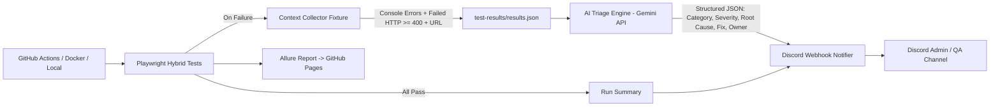

# AI Test Triage Bot — Hybrid E2E Automation & AI Failure Analysis

[](https://github.com/Nolove098/ai-test-triage-bot/actions/workflows/playwright-ci.yml)
[](https://playwright.dev/)
[](https://www.typescriptlang.org/)
[](https://ai.google.dev/)
[](https://discord.com/)
[](https://nolove098.github.io/ai-test-triage-bot/)

A production-grade **Hybrid UI + API Test Automation Framework** built with **Playwright** and **TypeScript**, featuring an **AI-Powered Failure Triage Engine** (`@google/genai` / `gemini-3-flash-preview` with automatic model fallback) and real-time **Discord Webhook Alerting** for [Automation Exercise](https://automationexercise.com).

> **Live Allure Report:** [https://nolove098.github.io/ai-test-triage-bot/](https://nolove098.github.io/ai-test-triage-bot/)

---

## Discord AI Triage Demo Preview

When tests fail in local runs or GitHub Actions, the framework automatically collects runtime browser errors and HTTP `>= 400` responses, sends them to **Gemini AI** with strict JSON schema enforcement, and dispatches Rich Embeds to Discord:

> _Placeholder: Paste your live Discord AI Triage Rich Embed screenshot below after configuring `DISCORD_WEBHOOK_URL` and running the `@demo-fail` flow._
>
> ```markdown
> 
> ```

---

## System Architecture



---

## Key Engineering Highlights

- **Hybrid API + UI Architecture:** Combines Playwright `APIRequestContext` clients (`AuthClient`, `ProductClient`) with strict Page Object Model (`BasePage`, `HomePage`, `LoginPage`, `ProductsPage`, `CartPage`, `CheckoutPage`). Hybrid tests seed unique users via API (`registeredUser` fixture), execute UI checkout, and tear down via API—keeping tests atomic and parallel-safe.
- **JSON Schema Contract Testing:** Validates API responses against JSON Schemas (`src/api/schemas/`) using **Ajv** (`src/utils/schemaValidator.ts`) alongside response SLA assertions (`< 2000ms`) and negative-case coverage (`400`, `404`, `405`).
- **Context Collector Fixture (`src/fixtures/contextCollector.fixture.ts`):** Automatically listens for browser `console.error`, uncaught `pageerror` exceptions, and failed HTTP responses (`status >= 400`, capturing method, URL, status, and truncated response body), attaching them as `failure-context` JSON on test failure.
- **Structured AI Root-Cause Analysis (`src/triage/aiAnalyzer.ts`):** Uses `@google/genai` (`gemini-3-flash-preview` with automatic fallback to `gemini-3.1-flash-lite` / `gemini-3.8-flash`) with `responseMimeType: "application/json"` and strict `responseSchema` to classify failures into `UI_LOCATOR_CHANGED`, `BACKEND_API_ERROR`, `FLAKY_OR_NETWORK`, or `ASSERTION_BUG` with severity (`CRITICAL` / `HIGH` / `MEDIUM`), team owner (`Frontend` / `Backend` / `QA Automation`), root cause, and suggested fix—plus graceful fallback heuristics if `GEMINI_API_KEY` is absent.
- **Rate-Limit-Safe Discord Notifier (`src/triage/discordNotifier.ts`):** Posts a color-coded **Summary Embed** (Green `0x2ECC71` / Red `0xE74C3C`) with Allure & GitHub Actions links, followed by up to 5 **Triage Embeds** with field truncation (`<= 1000` chars) and `500ms` pacing between webhook calls.
- **CI/CD & Containerization:** GitHub Actions workflow (`.github/workflows/playwright-ci.yml`) supports `push`, `pull_request`, and manual `workflow_dispatch` suite selection (`all`, `api`, `ui`, `hybrid`, `demo-fail`), preserves Allure trend history on `gh-pages`, executes AI Triage with `if: always()`, and accurately reports build status.

---

## Project Structure

```text
ai-test-triage-bot/
├── .github/workflows/
│   └── playwright-ci.yml              # CI/CD: Run tests -> Allure gh-pages -> AI Triage
├── src/
│   ├── api/
│   │   ├── clients/                   # BaseApiClient.ts, AuthClient.ts, ProductClient.ts
│   │   └── schemas/                   # productsList, createAccount, userDetail JSON schemas
│   ├── fixtures/
│   │   ├── contextCollector.fixture.ts
│   │   └── base.fixture.ts            # POM, API clients & atomic registeredUser fixture
│   ├── pages/                         # BasePage, HomePage, LoginPage, ProductsPage, CartPage, CheckoutPage
│   ├── triage/
│   │   ├── types.ts
│   │   ├── reportParser.ts            # Parses test-results/results.json & failure-context
│   │   ├── aiAnalyzer.ts              # Gemini AI structured JSON triage + fallback
│   │   ├── discordNotifier.ts         # Rich Embed builder & Discord Webhook sender
│   │   └── runTriage.ts               # Orchestrator script (npm run triage)
│   ├── test-data/
│   │   ├── searchData.json
│   │   └── dataGenerator.ts           # Faker user profile generator
│   └── utils/
│       ├── env.ts                     # Typed environment loader & validator
│       └── schemaValidator.ts         # Ajv schema validator helper
├── tests/
│   ├── api/                           # products.api.spec.ts, auth.api.spec.ts
│   ├── ui/                            # search-filter.spec.ts
│   ├── hybrid/                        # hybrid-order.spec.ts
│   └── demo/                          # intentional-failures.spec.ts (@demo-fail)
├── .env.example
├── Dockerfile
├── docker-compose.yml
└── playwright.config.ts
```

---

## Quick Start Guide

### 1. Local Setup

```bash
git clone https://github.com/Nolove098/ai-test-triage-bot.git
cd ai-test-triage-bot
npm install
npx playwright install
```

### 2. Configure Environment Variables

Copy `.env.example` to `.env` and populate your credentials:

```bash
cp .env.example .env
```

```env
BASE_URL=https://automationexercise.com
GEMINI_API_KEY=your_gemini_api_key
DISCORD_WEBHOOK_URL=your_discord_webhook_url
ALLURE_REPORT_URL=
GITHUB_RUN_URL=
```

> **GitHub Actions Setup:** Add `GEMINI_API_KEY` and `DISCORD_WEBHOOK_URL` under **Settings → Secrets and variables → Actions**, and enable **GitHub Pages** deploying from the `gh-pages` branch.

### 3. Run Normal Test Suites

```bash
# Run all production test suites (excludes @demo-fail)
npm test

# Run individual test layers
npm run test:api
npm run test:ui
npm run test:hybrid

# Generate and open Allure Report locally
npm run report:allure
```

### 4. Demo the AI Failure Triage Flow (`@demo-fail`)

Run the intentional failure suite (simulating a Backend HTTP `500 NullPointerException in PaymentService` and a broken UI locator `#non-existent-checkout-btn`), then run the AI Triage engine:

```bash
npm run test:demo-fail
npm run triage
```

> Note: If `GEMINI_API_KEY` or `DISCORD_WEBHOOK_URL` is omitted locally, `npm run triage` gracefully falls back to rule-based diagnostics and prints the Discord Rich Embed payload preview to the terminal.

### 5. Run with Docker

```bash
# Build and run tests + triage using Docker Compose (mounts allure-results & test-results)
docker compose up --build

# Or build and run the Playwright image directly
docker build -t ai-test-triage-bot .
docker run --rm --ipc=host --env-file .env ai-test-triage-bot
```
